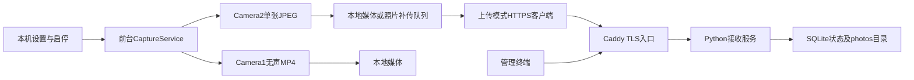

# Android拍摄与接收服务架构

## 运行链路

## 代码职责

Java源码位于 `android/app/src/main/java/org/family/capture/`。

| 类 | 职责 |
| --- | --- |
| `MainActivity` | 保存位置、方案参数、起始镜头、交替配置、启停和最近录像结果 |
| `LightActivity` | 显式浅色窗口/内容背景、正常和禁用文字颜色；不修改字体尺寸 |
| `CaptureService` | 常驻通知、唤醒锁、串行任务、阶段推进、上传及状态回报 |
| `CameraEngine` | Camera2 JPEG、20秒超时、原子文件提交及资源关闭 |
| `VideoEngine` | Camera1、无声H.264/MP4、录像尺寸/帧率选择、停止及元数据校验 |
| `OffscreenPreview` | EGL上下文和预览纹理，持续消费旧相机预览缓冲 |
| `LensSchedule` | 单调时钟驱动的镜头交替计算 |
| `PhotosActivity` | 点击预览、多选、确认删除、系统文档选择器导出ZIP |
| `PlaybackActivity` | 使用文件描述符播放私有MP4、进度和错误提示 |
| `MediaNames` / `MediaArchive` | 可读文件名、旧名转换及流式ZIP导出 |

## 拍摄时序

普通本地照片方案：立即拍第一张，然后按间隔拍照直到停止。

循环方案：`photo → video → rest → photo`。照片间隔只在photo阶段生效；阶段结束时若仍在拍照，则等待完成后进入video。录像持续2–60秒，默认5秒；rest结束才开始新一轮。相机初始化、拍摄耗时和释放缓冲会增加实际周期，不提供硬实时保证。

例：间隔30秒、photo30秒、video5秒、rest10秒，每轮预计1张照片加1段视频。间隔改10秒、photo仍30秒，则预计约3张。照片与录像不会并行。

`busy` 避免重叠操作，完成操作后增加1秒硬件释放缓冲。`LensSchedule` 只在非busy时检查交替期限，运行中的片段不中断；计时包含等待时间。长操作推迟切换，不补做多次错过的切换。自动交替仅限本地模式。

## 录像兼容策略

旧实现使用Camera2单录像输出和固定15fps；v0.4.0改为Camera1及持续取帧的预览纹理，选择设备支持的视频尺寸、参考设备profile帧率并匹配预览fps范围。先调用MediaRecorder.stop完成MP4，再释放录制器、相机和预览。文件经时长元数据检查后从 `.part` 改名。没有麦克风权限，不录音。

元数据有效不代表画面、方向、时长及播放均已真机验收。失败保留具体阶段到 `runtime.videoStatus`，后续拍照状态不会覆盖它；未完成片段被删除。单独5秒录像测试结束后服务自动停止。

## 线程、生命周期和存储

摄像头操作在一个HandlerThread执行；上传在独立单线程executor执行。网络轮询不会启动本地模式，已停止服务不能被远程重新唤醒。服务为START_NOT_STICKY，没有开机自启。停止时移除定时任务、关闭相机/录像并释放唤醒锁；系统杀进程、强停和断电须按设备步骤验收。

| 位置 | 内容 | 清理规则 |
| --- | --- | --- |
| 手机私有 `files/local-photos/` | 本地JPG/MP4 | 用户批量删除；不自动上传；卸载/清数据丢失 |
| 手机私有 `files/queue/` | 上传模式JPG | 收到201后删除；失败保留 |
| SharedPreferences `config` | 本机方案、地址和令牌 | 仅应用私有，非现代硬件安全存储 |
| SharedPreferences `runtime` | 最近状态/录像结果 | 历史事件，不保证进程仍存活 |
| 服务端 `CAPTURE_DATA/state.db` | 配置、状态、上传哈希 | SQLite事务持久化 |
| 服务端 `CAPTURE_DATA/photos/` | 已接收JPEG | 需人工归档及磁盘监控 |

队列约256MiB上限；照片可用空间阈值32MiB、录像64MiB。达到条件暂停新增而非自动删除旧文件。MP4仅本地，不进入上传队列。

上传模式每轮先拉配置、发状态，再最多补传3张，正常轮询间隔5秒；网络超时和上传会增加控制延迟，失败退避最长60秒。服务器以最近回报超过90秒判断离线。期望配置与实际回报分别保存。
