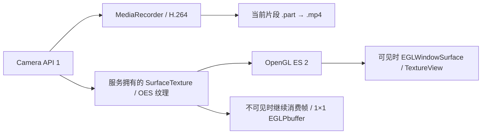

# Vehicle Recorder 开发文档 · 1.1.0

## 目标与实测反馈

设备目标：OPPO R7sm，Android 5–8 / API 21 起。用户在 1.0.0 真机试用中反馈预览非常卡顿、录像中无法调整设置、启动需要手动开始、文件名难以辨认、界面及录像库过于简陋。

1.1.0 针对这些问题更新。本文说明实现、兼容边界及验证方法。自动化检查不能替代 R7sm 真机性能验证。

## 预览卡顿：已定位的代码原因

旧实现主动将画面限制为每 500 ms 刷新一次，理论上只有约 2 fps；同时每次通过 `glReadPixels` 读回 640×360 RGBA 图像，创建 Bitmap，复制至 CPU，再交由 ImageView 显示。这会产生 GPU/CPU 同步、内存分配和垃圾回收负担。显示的 2 fps 不等于 H.264 文件实际编码帧率；实测必须分别检查预览与文件回放。

新实现保留服务拥有的 Camera SurfaceTexture，直接将外部 OES 纹理通过 OpenGL ES 2 绘制到 TextureView 对应的 EGLWindowSurface。正常帧路径无像素回读、Bitmap 创建或 CPU 像素复制；纹理矩阵、顶点缓冲和 shader 位置缓存复用。默认目标预览 30 fps，可调 15 fps；目标录像 30 或 24 fps，受设备 CamcorderProfile 限制。Camera 使用 recording hint，并优先选择包含目标帧率的窄 FPS 范围，减少自动预览帧率波动。

文件系统统计移至后台执行器，界面状态每秒刷新，与视频帧刷新解耦。设置路径写入验证在独立线程执行。



TextureView 的销毁不会释放相机输入纹理。Activity 暂停时撤去显示输出，服务继续更新输入纹理并维持编码。恢复时重新挂接显示 Surface，无需切段。显示 Surface 失效只撤去显示窗口，不因 UI 生命周期事件主动停止录像。

## 模块职责

| 文件 | 职责 |
|---|---|
| `MainActivity` | 全屏预览叠层、状态 HUD、快捷控制、首次打开自动录制、权限请求 |
| `Ui` | 深色配色、dp 尺寸、圆角控件和公共 UI 帮助方法 |
| `SettingsPanel` | 三页设置面板，构造设置快照，异步验证目录并提交 configure 命令 |
| `RecorderService` | 前台通知、唤醒锁、串行相机线程、编码、分段、镜头切换和设置事务 |
| `OffscreenPreview` | 兼容保留的类名；实现 GPU 显示输出和无显示时的输入帧消费 |
| `SettingsPolicy` | 判断设置变化是否需要结束当前片段 |
| `Config` | 默认值、设置读取、分段空间预留和当前录制设置快照 |
| `ClipNames` | 新旧命名识别、中文镜头名、本地日期时间及碰撞消解 |
| `LoopStore` | 配额计算、最旧未锁定录像清理、磁盘余量保护 |
| `ClipsActivity` | 卡片列表、容量条、全部/保护/前置/后置筛选、播放及管理 |
| `ClipProvider` | 对明确授权播放器提供受限只读内容 URI |

相机、MediaRecorder、EGL 的操作均在 `vehicle-camera` HandlerThread 中串行执行；Activity 只提交命令。UI 显示 Surface 在创建、暂停、恢复及销毁时挂接/撤去，由服务队列释放替换的 Surface。停止或分段时清理旧回调，generation 防止过期的编码/相机回调操作下一片段。

## 启动自动录像

默认 `auto_start=true`。Activity 新建且没有活动录制会话时请求必要权限，权限已具备则直接开始；首次授权成功后自动继续，不需要再次点击开始。

`onResume` 不触发自动开始，因此在用户手动停止之后，浏览录像库、返回主界面、从播放器返回均不会意外重启。正在录制时重新打开主界面不会重复启动或额外切段。自动开始可在“运行偏好”关闭。开机、强制停止、系统杀进程后没有系统自动重启录像行为。

权限：相机、外部存储；录音开启时麦克风。设置中开启录音但缺少麦克风权限时，先请求权限，再由用户重新保存设置。未授权时不绕过系统权限录制。

## 录制中的设置事务

浏览或取消设置不会停止 MediaRecorder。保存时构造 Bundle 快照，校验容量和路径，在后台创建/删除测试文件验证可写；失败不修改原设置，也不先停止当前录像。

| 变化 | 应用方式 |
|---|---|
| 仅启动自动录像开关 | 更新偏好，不切断当前片段 |
| 仅预览帧率 15 / 30 | 更新渲染节流，不切断当前片段 |
| 无值变化 | 不切段 |
| 画质、录像帧率、方向、录音、防抖、补光 | 服务线程先结束并保存旧片段，再提交设置、重新打开相机并录制 |
| 路径、容量或每段时长 | 同上；旧片段留在旧路径，新片段在新路径按新配额创建 |
| 停止状态保存 | 仅更新设置，不因为保存设置而自动开始录像 |

顺序：比较设置 → 必要时 finishClip（旧设置仍有效）→ Editor.apply → beginClip（新设置）→ 新的回调 generation。唤醒锁在录制设置切换期间保留。Android API 1 相机/编码器重启会有短暂空隙，不承诺无缝切换。如果新配置无法应用，明确停止并提示原因，不伪装继续录制。

## 文件命名与兼容

新文件示例：

```text
后摄像头_20261027_131205_123.mp4
前摄像头_20261027_131505_456.mp4
后摄像头_20261027_131205_123_1.mp4  # 同名冲突的序号
```

日期和时间来自手机当前时区；毫秒及碰撞序号避免快速切换、重复时间或系统时钟回退导致覆盖。检查 `.part`、`.mp4` 及对应 `.lock` 是否存在后选择可用名称。

录制中后缀 `.part`，完成后改为 `.mp4`；保护标记为完整视频路径追加 `.lock`。保护标记迁移成功后才改名，失败保留原始文件和保护信息。

所有权匹配同时支持旧格式 `VR_<数字>_[FB].mp4/.part` 和新中文格式；旧录像不做批量改名，避免改变用户存档。新旧录像都计入配额、可筛选回放及保护管理；无关命名文件和标记文件不会被当作视频清理。

## 存储与后台约束

默认 720p、4 Mbps、3 分钟、2048 MB；1080p 8 Mbps。音频 AAC 96 kbps。空间预留按视频码率加音频余量和 4 MB 容器余量估算。每段开始预留容量及至少 64 MB 物理可用空间；录制中每 2 秒检查，低于 16 MB 则尝试停止并保存。MediaRecorder 最大文件大小仍是平台提供的限制，容器开销和其他应用抢占磁盘会影响结果。

锁定文件包含在配额内，不能自动删除。锁定文件占满空间则拒绝继续录制。LoopStore 清理与录像库保护/删除通过同一个类锁协调。损坏的未锁定 `.part` 计入空间并可由后续循环清理；未实现断电 MP4 修复。

前台服务、PARTIAL_WAKE_LOCK、服务独立预览输入支持熄屏录制；ColorOS 仍须允许后台运行和自启动。不能保证系统强杀、拔卡、断电或过热后继续录制。此项目不作为 Android 9+ 通用后台相机实现。

## 构建与验证

工具链：JDK 17、Gradle 8.9、AGP 8.6.1、compileSdk 35、minSdk 21、targetSdk 28。没有第三方运行时库；按旧机兼容目标避免使用 API 24 才有的 Comparator 工厂方法。

```sh
cd vehicle-recorder
bash tests/check.sh
gradle --no-daemon :app:assembleDebug :app:lintDebug
```

GitHub Actions 执行同样检查并上传测试 APK。Debug 签名自本版起使用缓存保持后续构建一致；缓存丢失仍会产生不同签名，不等同于正式发布签名。旧版本与新包签名可能不同，出现安装签名冲突时先备份录像/记录路径，再卸载旧包安装；应用专用目录会随卸载删除。正式分发应自行配置并长期保存 release 密钥，不能依赖测试缓存。

自动化覆盖：旧录像清理、配额/物理空间不足拒绝、锁定保护、中文日期名、同一时间碰撞消解、新旧所有权兼容、无关文件保护、设置不变和仅预览/自动启动变化不切段、存储/编码设置变化要求安全切段；另含 Java 语法和 XML 检查。Android API 解析与兼容性由编译及 lint 检查。

## R7sm 真机回归清单（待新版实测）

1. 记录 Android/ColorOS、设备剩余空间、前后摄像头规格。
2. 首次授权后自动开始；正常重开应用自动开始；手动停止后进入设置、录像库并返回不应重启。
3. 固定场景持续横向移动相机：对比旧版约 2 fps 预览与新 GPU 预览；分别测试 720p/30、720p/24、1080p/30。新预览目标 15/30 fps 并非真机保证值。
4. 录制中打开设置 30 秒并取消：原片段时长继续增长；仅切换预览帧率、自动启动不切段。
5. 录制中改画质、录音、时长、目录、容量：旧片段可播放，新片段自动产生，新路径/设置生效；无权限路径失败时原片段继续。
6. 前后镜头连续切换，检查新名字、方向和声音；手动设相同系统时间，确保已有文件不会覆盖。
7. 新旧文件共存时循环覆盖、筛选、保护、解保护、删除、回放；锁定占满时保留原文件并停止。
8. 熄屏 30 分钟，返回桌面、录像库、播放器并回来：预览恢复不主动切段，所有已完成片段可播放。
9. 固定光照下连续录像两小时，对已保存视频记录实际帧率、掉帧、分段间隔、音画同步、温度和耗电；低光照与过热应单独记录。

可用 ffprobe 查看文件帧率、时长与帧间隔（电脑安装 FFmpeg 后）：

```sh
ffprobe -v error -select_streams v:0 -show_entries stream=codec_name,width,height,r_frame_rate,avg_frame_rate,nb_frames,duration -of json '后摄像头_20261027_131205_123.mp4'
ffprobe -v error -select_streams v:0 -show_entries frame=best_effort_timestamp_time -of csv=p=0 '后摄像头_20261027_131205_123.mp4'
```

`r_frame_rate`/`avg_frame_rate` 不能单独证明无丢帧；结合逐帧时间戳、运动画面回放和实际段长评估。预览顺滑与保存文件顺滑必须分别验收。

## 本版交付验证记录

- 源码提交：`7d21f135385c5ee6830e15fa109be0cf0a66c35e`。
- [GitHub Actions 构建](https://github.com/kafeiwu2012/Family-Interaction-Platform-Design/actions/runs/40454646205)：Java 策略测试、语法/XML、APK 编译及 Android lint 全部通过。
- [1.1.0 测试 APK](../downloads/vehicle-recorder-1.1.0-debug.apk?raw=true)；SHA-256 见 downloads/SHA256SUMS。
- 已比较 APK 签名公钥：本仓库 1.0.0 测试包与 1.1.0 的签名不同，不能覆盖安装；须先备份录像并记录原目录，再卸载旧版安装新版。应用专用目录卸载会删除。
- 尚未实测：本版在 OPPO R7sm 上的实际预览帧率、保存文件掉帧、熄屏 30 分钟和两小时温控稳定性。
